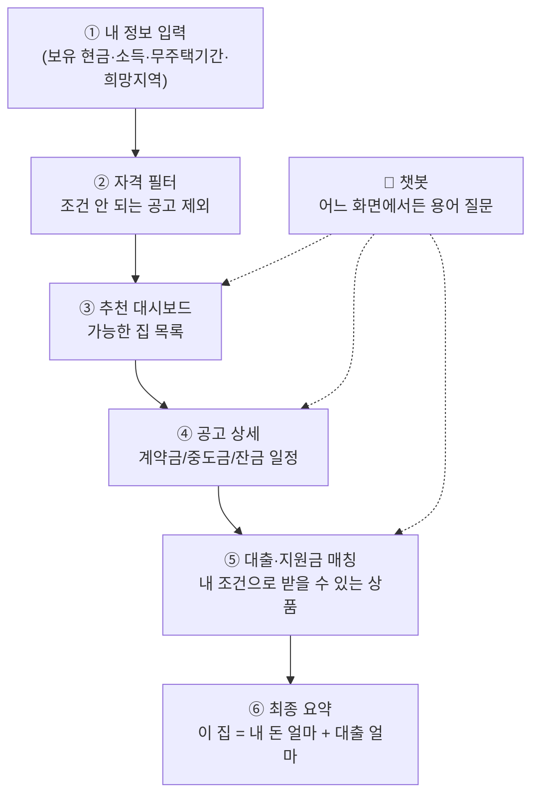

# 청약 전략 플랫폼 — 주제 방향성 정리

> 2026년 9월 17일 팀 논의(음성 녹음) 정리본
> 참고 문서: `260917_2_청약_플랫폼_폴더구조.pdf`, `README.md`

---

## 0. 한 줄 요약

**"내 조건(보유 현금·소득·무주택기간·희망지역)을 넣으면, 청약홈 APT 공고 중에서 계약금 범위에 들어오는 집과 그 집에 연결할 대출을 보여주는 포털"**

LH, SH, 챗봇, 앱은 이 한 줄이 브라우저에서 돌아간 뒤에 붙입니다.

---

## 하지 말 것

아래는 범위에서 빼는 일이 아닙니다. **순서를 앞당기면 확인도 못 한 채로 화면·DB·수집 코드를 다시 짜게 되는 일**입니다.

| 미루는 일 | 이유 | 언제 |
|---|---|---|
| SH 크롤링, 다방·직방·피터팬 | API가 없거나 민간 매물. 1차 동작과 무관 | 청약홈·LH·대출 화면이 된 뒤 |
| 오피스텔·잔여세대·공공지원 민간임대 API를 첫 수집에 포함 | 엔드포인트가 여러 개. 첫 성공은 APT 분양 + 주택형별이면 됨 | APT 두 개가 DB에 들어간 뒤 |
| 개인신용대출 API | 집 계약금·주택담보·전세와 다른 상품 | 이번 범위 밖 |
| 정책대출 사이트 크롤링, 공고 PDF 파싱 | 건수가 적거나 형식이 단지마다 다름 | 10% 가정이 화면에 나온 뒤. 정책대출은 표로 손으로 정리 |
| 6장 필드명으로 `models/`를 먼저 수정 | 필드명은 기술문서 기준 **후보**. 실제 JSON과 다르면 테이블을 다시 만듦 | 브라우저에서 청약홈 JSON을 본 뒤 |
| Flutter, PWA, 웹뷰, 스토어, 로그인, 지도, 푸시 알림 | 백엔드 없이 화면만 두 벌이 됨 | 웹에서 목록·대출 계산이 된 뒤 |
| Hugging Face, 챗봇에게 자격·금액 판단 시키기 | 검색·설명용. 숫자와 자격은 `services/` 코드 | STEP 8 |
| API 키를 이 문서, 채팅, git에 적기 | 키는 `backend/.env`만. `house.venv/`도 커밋하지 않음 | 항상 |
| `main`에 바로 실험 커밋 | 수집 실험은 브랜치에서 | 코드를 건드리기 시작할 때부터 |

**지금 하는 일은 하나**입니다. 청약홈 API 키를 받아 6-1 주소로 JSON이 보이는지 확인합니다. LH·금감원 키는 그 데이터를 코드로 받을 차례가 오면 받습니다.

---

## 1. 왜 만드나 (문제 정의)

논의에서 나온 실제 불편함입니다.

| 지금 겪는 불편 | 우리가 해결할 방법 |
|---|---|
| 청약홈, LH, SH를 **따로따로** 들어가서 봐야 함 | 한 화면에서 통합 검색 |
| 공고를 봐도 **내가 자격이 되는지 모름** | 내 조건 입력 → 자격 되는 것만 필터 |
| 집을 찾아도 **대출 조건이 너무 많아서** 뭘 쓸 수 있는지 모름 | 집 + 대출/지원금을 묶어서 제시 |
| 지원금이 있는지도 모르고, **자격 요건이 흩어져 있음** | 지원금 자격 요건을 같이 표시 |
| 공고문 용어(계약금·중도금·잔금)가 **어려움** | 옆에 붙은 챗봇에게 바로 질문 |

### 핵심 아이디어: "내 돈 기준 역산"

논의 중 나온 가장 중요한 아이디어입니다.

- 청약 아파트는 보통 **계약금 10%를 자기 돈으로 먼저** 내야 대출이 시작됩니다.
- 그래서 **"내가 2,000만 원 있다"** → 계약금 10% 기준이면 **2억 원대 집**이 후보가 됩니다.
- 그 다음 **"나머지 1억 8천은 어떤 대출로 메꿀 수 있나"** 를 계산해 줍니다.

즉 `보유 현금 → 가능한 분양가 범위 → 가능한 대출 상품` 순서로 거꾸로 계산하는 게 이 서비스의 차별점입니다.

---

## 2. 서비스 흐름



---

## 3. 화면 구성 (확정)

논의에서 정리된 화면은 **3 + 1** 구조입니다.

| # | 화면 | 하는 일 |
|---|---|---|
| 1 | **일반 검색** | 지역·가격으로 그냥 검색 (로그인 없이도 가능) |
| 2 | **조건 필터 검색** | 내 정보를 넣고 "자격 되는 것만" 보기 |
| 3 | **대출 시뮬레이션** | 이 집을 살 때 내 돈 얼마 / 대출 얼마 |
| + | **챗봇 (사이드바)** | 화면 어디서든 "이게 뭐야?" 바로 질문 |

PC에서는 사이드바, 모바일에서는 하단 버튼으로 엽니다. 사이드바만 확정으로 두고 화면을 만들면 모바일에서 다시 짜게 됩니다. 챗봇 구현 자체는 STEP 8입니다.

---

## 4. 데이터 범위 (1차 / 2차)

| 단계 | 포함 | 비고 |
|---|---|---|
| **1차** | 청약홈 APT 분양정보 + 주택형별 | 목록과 계약금 10% 가정 계산의 최소 범위 |
| **1차 다음** | LH 공고, 금감원 주택담보·전세자금대출 | 청약홈 JSON을 본 뒤에 키 발급·수집 |
| **나중** | 정책대출 수기 표, 마이홈, SH 크롤링, 실거래가, 공고 PDF | SH는 API가 없음. 1차 필수에 넣지 않음 |
| **2차** | 다방·직방·피터팬의 방 구하기 | 민간 부동산. 웹이 된 뒤 |
| **보류** | 분양 분석표 / 투자 분석 이미지 | 실사용성이 낮음. 추가 기능으로만 |
| **범위 밖** | 개인신용대출, 지도, 로그인, 푸시 알림 | 집 찾기·대출 연결이 된 뒤에 다시 판단 |

> 보류 결정 이유: *"실제로 제가 이걸 쓸까 생각해봤는데, 안 쓸 것 같아요. 귀찮거든요."*
> → 다 만들고 나서 추가 기능으로 붙이기로 함.

---

## 5. 비전공자를 위한 진행 순서

**한 번에 다 하려고 하지 말고, 아래 순서대로 한 칸씩** 채우면 됩니다.
지금은 **STEP 2** 위치입니다.

### STEP 0 — 환경 만들기

가상환경은 `backend/house.venv`로 만들어 둔 상태입니다. 패키지가 없으면 키를 기다리는 동안 설치합니다. 설치가 끝났다고 수집 코드를 시작하지는 않습니다.

```powershell
cd backend
house.venv\Scripts\activate
pip install -r requirements.txt
```

### STEP 1 — 뼈대 확인 ✅ (완료)

폴더 구조는 이미 만들어져 있습니다. (`260917_2_청약_플랫폼_폴더구조.pdf` 참고)
**지금은 파일만 있고 내용은 비어 있는 상태**가 정상입니다.

### STEP 2 — 데이터 찾기 ⬅️ **지금 여기**

> *"DB 영역이 가장 확립이 안 돼요. 데이터부터 일단 찾아야 될 것 같아요."*

**할 일:** 청약홈 API **하나만** 키를 받고, 6-1 주소로 JSON이 보이는지 확인합니다.
LH·금감원·마이홈 키와 나머지 엔드포인트는 이 JSON을 본 뒤로 미룹니다.
**브라우저에 주택명·접수일이 보이면 성공**입니다. 그 화면을 저장해 두고, 그 전에 `models/`는 고치지 않습니다.

### STEP 3 — 표(테이블) 모양 정하기

받아온 데이터를 보면서 "우리 DB에 어떤 칸이 필요한지" 정합니다.
👉 `backend/app/models/` 안의 파일들을 고치는 작업

### STEP 4 — 수집기 만들기

API에서 데이터를 가져와 DB에 넣는 코드.
👉 `backend/app/data_pipeline/applyhome_client.py` (현재 TODO 상태)

### STEP 5 — 자격 필터 만들기 (핵심)

내 조건으로 공고를 걸러내는 로직.
👉 `backend/app/services/eligibility_filter.py` (현재 무조건 통과하는 상태)

### STEP 6 — 대출 매칭 만들기

계약금 10% 역산 + 대출 상품 매칭.
👉 `backend/app/services/loan_matcher.py`

### STEP 7 — 화면 연결하기

입력폼에서 백엔드로 데이터 보내기.
👉 `frontend/src/pages/InputFormPage.jsx`

### STEP 8 — 챗봇 붙이기

👉 `backend/app/api/routes/chat.py`

---

## 6. DB — 어디서 무엇을 가져올까 ⭐

> **먼저 할 일:** [공공데이터포털](https://www.data.go.kr) 회원가입 → 아래 API마다 **활용신청** → 마이페이지에서 **일반 인증키(Decoding)** 복사
> 대부분 **자동승인**이라 신청 즉시 키가 나옵니다. 전부 **무료**입니다.

### 6-1. 청약 공고 (가장 중요)

**한국부동산원 청약홈 분양정보 조회 서비스**
🔗 https://www.data.go.kr/data/15098547/openapi.do
📄 기술문서: https://www.reb.or.kr/reb/na/ntt/selectNttInfo.do?mi=10251&bbsId=1268&nttSn=79889

| 가져올 것 | 엔드포인트 |
|---|---|
| APT 분양정보 | `https://api.odcloud.kr/api/ApplyhomeInfoDetailSvc/v1/getAPTLttotPblancDetail` |
| APT 주택형별 (평형·분양가) | `.../getAPTLttotPblancMdl` |
| 오피스텔/도시형/민간임대 | `.../getUrbtyOfctlLttotPblancDetail` |
| 잔여세대(무순위) | `.../getRemndrLttotPblancDetail` |
| 공공지원 민간임대 | `.../getPblPvtRentLttotPblancDetail` |

**호출 예시** (브라우저에 그대로 붙여넣어 확인 가능)

```
https://api.odcloud.kr/api/ApplyhomeInfoDetailSvc/v1/getAPTLttotPblancDetail
  ?serviceKey=발급받은키
  &page=1
  &perPage=100
  &cond[RCRIT_PBLANC_DE::GTE]=2026-01-01
```

**가져와야 할 항목 후보 → `models/listing.py`**

> 아래 영문 필드명은 기술문서를 보고 적은 **후보**입니다. 브라우저 JSON에 같은 이름이 있는지 확인하기 전에는 테이블 수정·수집 코드 작성을 시작하지 않습니다.
> 첫 호출은 APT 분양정보와 주택형별 두 개만 합니다.

| 항목 | 필드명 | 왜 필요한가 |
|---|---|---|
| 공고번호 | `PBLANC_NO` | 고유 키 |
| 주택명 | `HOUSE_NM` | 화면 표시 |
| 공급지역명 | `SUBSCRPT_AREA_CODE_NM` | 지역 필터 |
| 공급위치 | `HSSPLY_ADRES` | 지도·상세 |
| 모집공고일 | `RCRIT_PBLANC_DE` | 최신순 정렬 |
| 접수 시작/종료일 | `RCEPT_BGNDE` / `RCEPT_ENDDE` | 마감 임박 알림 |
| 당첨자발표일 | `PRZWNER_PRESNATN_DE` | 일정 안내 |
| 공급규모 | `TOT_SUPLY_HSHLDCO` | 경쟁률 감 |
| 분양가(주택형별) | `LTTOT_TOP_AMOUNT` | ⭐ **계약금 10% 역산의 기준** |
| 전용면적 | `EXCLUSE_AR` | 평형 필터 |
| 공고 URL | `PBLANC_URL` | 원문 링크 |

> ⚠️ 분양가는 **주택형별 API(`...Mdl`)** 에 있습니다. 공고 API와 **공고번호로 합쳐야** 합니다.
> ⚠️ 분양가 단위는 **만원**입니다.

### 6-2. LH 공공임대·분양

**한국토지주택공사 분양임대공고문 조회 서비스**
🔗 https://www.data.go.kr/data/15058530/openapi.do
📍 요청주소: `http://apis.data.go.kr/B552555/lhLeaseNoticeInfo1`

| 파라미터 | 값 |
|---|---|
| `UPP_AIS_TP_CD` | `05`=분양주택, `06`=임대주택, `13`=주거복지, `39`=신혼희망타운 |
| `CNP_CD` | 지역코드 (예: `11`=서울) |
| `PAN_SS` | `공고중` / `접수중` / `접수마감` |
| `PAN_NT_ST_DT` | 공고 게시일 (필수) |
| `CLSG_DT` | 공고 마감일 (필수) |

**한국토지주택공사 임대주택단지 조회 서비스** (단지별 보증금·월세)
🔗 https://www.data.go.kr/data/15059475/openapi.do
📍 `http://apis.data.go.kr/B552555/lhLeaseInfo1/lhLeaseInfo1`
→ 단지명, 주소, 공급유형(영구/국민임대/행복주택), 총세대수, 전용면적, **임대보증금·월임대료**

원문 사이트: https://apply.lh.or.kr

### 6-3. SH (서울주택도시공사)

> ⚠️ **SH는 공식 오픈 API가 없습니다.** 게시판 HTML을 직접 읽어와야 합니다(크롤링).

🔗 공고 게시판: https://www.i-sh.co.kr/app/lay2/program/S1T294C297/www/brd/m_247/list.do

| 게시판 | 파라미터 |
|---|---|
| 주택임대 | `multi_itm_seq=2` |
| 주택분양 | `multi_itm_seq=1` |
| 주택매입·주거복지 | `multi_itm_seq=512` |

- 제목 검색: `&srchWord=검색어&srchTp=0`
- 페이지당 10건 고정, `page` 로 페이지 넘김
- 공공데이터 안내 페이지: https://www.i-sh.co.kr/app/lay2/S1T367C437/sublink.do

> 크롤링은 STEP 2에서 하지 말고 **가장 마지막**으로 미루세요. 청약홈+LH만으로도 충분히 돌아갑니다.

### 6-4. 마이홈포털 (공공임대 통합)

**국토교통부 마이홈포털 공공임대주택단지 정보 조회**
🔗 https://www.data.go.kr/data/15110581/openapi.do
📍 `https://apis.data.go.kr/1613000/HWSPR04/rentalHouseGwList`
- 필수: `serviceKey`, `brtcCode`(광역시도 2자리), `signguCode`(시군구 3자리)
- 국민임대 / 영구임대 / 행복주택 유형별 제공
- 원문 사이트: https://www.myhome.go.kr

### 6-5. 대출 상품 ⭐

**금융감독원 「금융상품 한눈에」 오픈API**
🔗 인증키 신청: https://finlife.fss.or.kr/finlife/api/finlifeApiKey/list.do?menuNo=700034
🔗 API 소개: https://finlife.fss.or.kr/finlife/main/contents.do?menuNo=700029

> ⚠️ 이건 **공공데이터포털이 아니라 금감원 사이트에서 따로** 키를 받아야 합니다.

| 가져올 것 | 엔드포인트 |
|---|---|
| 주택담보대출 | `https://finlife.fss.or.kr/finlifeapi/mortgageLoanProductsSearch.json?auth=키&topFinGrpNo=050000&pageNo=1` |
| 전세자금대출 | `.../rentHouseLoanProductsSearch.json?auth=키&topFinGrpNo=050000&pageNo=1` |
| 개인신용대출 | 이번 범위 밖. 엔드포인트는 적지 않음 |

**가져와야 할 항목 → `models/loan_product.py`**

| 항목 | 왜 필요한가 |
|---|---|
| 금융회사명 / 상품명 | 화면 표시 |
| 최저금리 / 최고금리 / 전월평균금리 | 비교·정렬 |
| 금리방식 (고정/변동) | 필터 |
| 상환방식 (원리금균등 등) | 시뮬레이션 계산 |
| 대출한도 | ⭐ 매칭 조건 |
| 가입방법 | 안내 |

**정책 대출 (API 없음 — 조건을 직접 정리해서 넣어야 함)**

| 상품 | 링크 |
|---|---|
| 디딤돌 / 버팀목 대출 | https://nhuf.molit.go.kr |
| 보금자리론 / 특례보금자리 | https://www.hf.go.kr |
| 청년·신혼부부 주거지원 | https://www.myhome.go.kr |

> 정책 대출은 **소득 기준·무주택 요건·한도**를 수동으로 표에 정리해 DB에 넣는 게 빠릅니다.

### 6-6. (선택) 시세 비교용 실거래가

**국토교통부 아파트 매매 실거래가**
🔗 https://www.data.go.kr/data/15126469/openapi.do
📍 `https://apis.data.go.kr/1613000/RTMSDataSvcAptTradeDev/getRTMSDataSvcAptTradeDev`
- 필수: `LAWD_CD`(법정동코드 앞 5자리), `DEAL_YMD`(YYYYMM)
- 법정동코드 조회: https://www.code.go.kr
- 용도: "이 분양가가 주변 시세보다 싼가?" 판단용 — **여유될 때**

### 6-7. 우선순위 정리

| 순위 | 데이터 | 난이도 | 없으면 서비스가 |
|---|---|---|---|
| 1️⃣ | 청약홈 APT 분양정보 + 주택형별 | 쉬움 | **안 돌아감** |
| 2️⃣ | 금감원 주택담보대출 | 쉬움 | 대출 기능 불가 |
| 3️⃣ | LH 공고 | 쉬움 | 공공임대 빠짐 |
| 4️⃣ | 정책대출(수동 정리) | 보통 | 지원금 안내 불가 |
| 5️⃣ | 마이홈포털 | 보통 | 있으면 좋음 |
| 6️⃣ | SH 크롤링 | 어려움 | 서울 공공만 빠짐 |
| 7️⃣ | 실거래가 | 보통 | 없어도 됨 |

---

## 7. 데이터 → 폴더 매핑

| 데이터 | 저장될 곳 | 수집 코드 |
|---|---|---|
| 청약홈 공고 | `models/listing.py` | `data_pipeline/applyhome_client.py` |
| LH·SH·마이홈 | `models/listing.py` (유형 컬럼 추가) | `data_pipeline/` 에 파일 추가 |
| 대출 상품 | `models/loan_product.py` | `data_pipeline/` 에 파일 추가 |
| 과거 경쟁률 | `models/historical_result.py` | 청약홈 경쟁률 API |
| 사용자 입력 | `models/user.py` | 프론트 입력폼 |

---

## 8. API vs 크롤링 — 언제 무엇을 쓰나

### 8-1. 판단 순서

새 데이터가 필요할 때마다 **위에서부터** 확인하고, 걸리는 데서 멈추면 됩니다.

1. **공공데이터포털에 API가 있나?** → 있으면 무조건 API
2. **그 기관 자체 API가 있나?** → 금감원 대출 API가 이 경우
3. **데이터가 수십 건 수준인가?** → 손으로 표에 옮기는 게 빠름 (정책대출)
4. **위 셋 다 아니면** → 그때 크롤링

> 크롤링은 **더 나아서 쓰는 게 아니라, API가 없어서 어쩔 수 없이 쓰는 것**입니다.

### 8-2. 흔한 오해 — "갱신이 잦으니 크롤링이 낫지 않나?"

**반대입니다. 갱신이 잦을수록 API가 유리합니다.**

| 오해 | 실제 |
|---|---|
| API는 키 받을 때 데이터를 한 번 받고 끝 | **부를 때마다 그 순간의 최신 데이터**를 줌 (청약홈·LH는 실시간) |
| 크롤링이 최신 반영에 유리 | 둘 다 주기적으로 돌려야 하는 건 똑같음 (`data_pipeline/scheduler.py`) |
| 크롤링이 더 자유롭다 | **게시판 디자인이 바뀌면 예고 없이 멈춤.** 에러도 안 나고 빈 값만 들어와서 며칠 뒤에야 알아챔 |

API는 기관이 형식을 바꿔도 공지를 하고 기존 항목은 유지합니다. 실제로 청약홈 기술문서를 보면 지난 2년간 항목을 **추가만** 했습니다.

### 8-3. 이 프로젝트에서 크롤링이 걸리는 지점 3곳

| 대상 | 왜 | 언제 할까 |
|---|---|---|
| **SH 공고** | API가 아예 없음 | **가장 마지막.** 빠져도 서울 공공임대 일부만 안 보임 |
| **정책대출 조건** | API 없음. 하지만 상품이 10개 남짓, 바뀌는 건 금리 숫자뿐 | **크롤링하지 말고 손으로 정리.** 분기에 한 번 5분 |
| **공고문 첨부 PDF** | 실제 납부 일정이 여기 들어 있음 | **정확도 개선 단계.** 아래 참고 |

### 8-4. 공고문 첨부 PDF 이야기 ⭐

> *"청약을 하면 거기에 파일이 있단 말이야... 계약할 때 1차 계약 10%, 중도금 이런 식으로 돼 있잖아"*

청약홈 API는 공고명·접수일·분양가 같은 **요약 정보만** 줍니다.
계약금을 언제 얼마씩 내는지, 중도금이 몇 회차인지 같은 **실제 납부 일정은 첨부 PDF 안에** 있습니다.
API 응답의 `PBLANC_URL`로 원문 페이지 링크는 오지만, 파일 내용까지는 안 옵니다.

**그래서 이렇게 갑니다.**

| 단계 | 방식 |
|---|---|
| 1차 (지금) | **계약금 10% 가정**으로 계산 + 화면에 "일반적인 기준"이라고 표시 + 공고 원문 링크 함께 제공 |
| 2차 (나중) | 첨부 PDF를 읽어서 단지별 실제 비율 반영 |

단지마다 계약금이 10%가 아니라 20%인 곳도 있어서, 정확도를 올리려면 결국 PDF를 봐야 합니다.
다만 **나머지가 다 돌아간 뒤**의 개선 작업입니다.

### 8-5. 크롤링이란 정확히 뭔가 (비전공자용)

**사람이 보는 웹페이지를 컴퓨터가 대신 열어서, 화면에 보이는 글자를 긁어오는 것**입니다.

API로 받으면 이렇게 옵니다 — 데이터만 깔끔하게.

```json
{ "HOUSE_NM": "○○자이", "RCEPT_BGNDE": "2026-09-20", "TOT_SUPLY_HSHLDCO": 320 }
```

API가 없는 SH는 이렇게 옵니다 — 데이터와 꾸밈이 뒤섞인 상태.

```html
<table class="board">
  <tr>
    <td class="num">1</td>
    <td class="subject"><a href="view.do?seq=304371">2026년 1차 행복주택 입주자 모집공고</a></td>
    <td class="date">2026-09-15</td>
  </tr>
</table>
```

여기서 제목과 날짜만 뽑아내는 게 크롤링입니다.

**실제 과정은 3단계**

```python
import requests
from bs4 import BeautifulSoup

url = "https://www.i-sh.co.kr/app/lay2/program/S1T294C297/www/brd/m_247/list.do"
html = requests.get(url, params={"multi_itm_seq": 2}).text   # ① 페이지를 통째로 받고
soup = BeautifulSoup(html, "html.parser")                    # ② 구조를 해석한 뒤

for row in soup.select("td.subject a"):                      # ③ 원하는 부분만 골라냄
    print(row.text.strip(), row["href"])
```

목록에서 얻은 링크(`view.do?seq=304371`)를 하나씩 다시 열어 본문을 긁습니다. 공고 30개면 요청을 31번 보내는 셈입니다.

**어려운 이유**

- 화면 구조가 바뀌면 깨짐 (`td.subject` → `td.title` 로 바뀌면 그날로 멈춤)
- F12 개발자 도구로 태그를 하나씩 찾아야 함 — 페이지마다 다시
- JavaScript로 나중에 채워지는 데이터는 안 잡힘 → Selenium/Playwright 필요
- 요청 간격을 1~2초씩 둬야 함. 너무 빠르면 IP 차단

---

## 9. PC · 모바일 대응 방향

### 9-1. 결론: 앱을 따로 만들지 않는다

**반응형 웹 하나로 만들고, 그걸 앱 껍데기에 넣는** 방식으로 갑니다.
백엔드는 PC든 앱이든 똑같은 API를 쓰기 때문에, 지금 구조 그대로 두면 됩니다.

| 방식 | 뭐냐면 | 난이도 | 스토어 등록 | 재작업량 |
|---|---|---|---|---|
| **반응형 웹** | 창 크기에 맞춰 화면이 접힘 | 낮음 | 불가 | — |
| **PWA** | 홈 화면에 설치. 아이콘 생기고 앱처럼 열림 | 낮음 | 불가(설치는 됨) | 없음 |
| **웹뷰 래핑** | 만든 웹을 앱 껍데기에 넣어 스토어 등록 | 중간 | 가능 | 없음 |
| **Flutter** | 코드 하나로 앱·PC 전부. 단 Dart 언어 | 높음 | 가능 | 화면 전부 |

**권장 순서: 반응형 웹 → PWA → (필요하면) 웹뷰 래핑**

### 9-2. 기획에서 바뀌는 것

| 항목 | 내용 |
|---|---|
| **모바일 우선 설계** | PC 먼저 그리고 줄이면 반드시 깨짐. 반대로 하면 PC는 여백만 넓어져서 자연스러움 |
| **챗봇 위치** | PC는 오른쪽 사이드바 / **모바일은 하단 버튼 → 전체화면**. 미리 정해둬야 안 꼬임 |
| **입력폼 쪼개기** | 보유현금·소득·무주택기간·희망지역을 모바일에서 한 페이지에 넣으면 스크롤 지옥 → **3~4단계로 분할** |
| **로그인** | 앱을 깔면 사용자는 내 정보가 저장돼 있길 기대함. 앱까지 간다면 언젠가는 필요 |
| **관심 공고 등록** | 자리만 잡아두기 → 나중에 푸시 알림으로 이어짐 |

### 9-3. 앱을 만드는 진짜 이유는 "알림"

반응형 웹만으로도 기능은 다 됩니다. 앱이 의미 있어지는 건 **푸시 알림** 때문입니다.

> "관심 등록한 공고 접수가 **내일 마감**입니다"

청약은 마감을 놓치면 끝이라 이게 꽤 강력합니다. 웹으로는 못 보냅니다.
그래서 **관심 공고 등록** 기능만 미리 자리를 잡아두면 나중에 자연스럽게 이어집니다.

### 9-4. Flutter — 지금은 아니고, 나중에

Flutter는 코드 하나로 안드로이드·iOS·웹·PC 앱을 다 만들 수 있어서 목표에는 맞는 도구입니다.
다만 **지금 시작하는 건 권하지 않습니다.**

**이유 1 — 언어가 다름.** Flutter는 **Dart**를 씁니다. 지금 `frontend/`의 React(JavaScript) 코드를 통째로 버리고 새 언어를 배워야 합니다.

**이유 2 — 팀 목표와 어긋남.**

> *"우리 팀원들이나 너네 팀원들이나, 여기 프로젝트 하는 애들이랑 **똑같은 시스템으로 가는데 주제만 다른 거**. 그래야 따라가니까."*
> *"최종 목적은 **4차에 따라갈 수 있는 능력을 갖추는 것**"*

다른 조가 React로 가는데 혼자 Flutter로 가면 막혔을 때 물어볼 사람이 없습니다.

#### 나중에 Flutter로 갈 때 — 뭐가 넘어가고 뭐가 안 넘어가나

| 그대로 씀 ✅ | 다시 써야 함 ❌ |
|---|---|
| `backend/` **전체** (서버는 누가 부르는지 구분 안 함) | JSX 컴포넌트 → Dart 위젯 |
| API 수집 코드, DB에 쌓은 데이터 | Redux → Provider |
| 자격 필터 · 계약금 역산 · 대출 매칭 로직 | CSS → Flutter 스타일 |
| 챗봇 | |
| 화면 설계 · 서비스 흐름 · 이 기획 문서 | |

**시간이 오래 걸리는 어려운 작업은 전부 백엔드에 있습니다.**
화면은 "무엇을 어떤 순서로 보여줄지" 아는 상태로 옮기는 거라 처음 만들 때보다 훨씬 빠릅니다.

#### Flutter 공부 로드맵 (웹 완성 후)

**시작 조건:** ① 웹에서 공고 목록·대출 계산이 실제로 돌아갈 것 ② API 응답 형식이 더 이상 안 바뀔 것

| 단계 | 배울 것 | 기간 |
|---|---|---|
| 1 | Dart 기초 — 변수, 함수, 클래스, **`async/await`**, null safety | 1주 |
| 2 | Flutter 위젯 — `Scaffold`, `Column`/`Row`, `ListView`, 화면 이동 | 2주 |
| 3 | 상태관리 — **Provider 하나만** (Redux와 개념 비슷) | 1주 |
| 4 | API 연동 — `http` 패키지로 JSON 받아 화면에 뿌리기 | 1주 |
| 5 | 빌드 — 안드로이드 APK 만들어 내 폰에 설치 | 며칠 |

- 1단계에서 **`async/await`가 제일 중요**합니다. API 호출이 전부 비동기라 여기서 막히면 4단계에서 멈춥니다.
- 공식 튜토리얼: https://docs.flutter.dev
- ⚠️ **iOS 빌드는 Mac이 필요합니다.** Windows에서는 안드로이드까지만 가능.
- ⚠️ 에뮬레이터는 무거우니 **실제 폰을 USB로 연결**해 테스트하는 게 빠릅니다.
- 처음부터 전체를 옮기려 하면 중간에 멈춥니다. **공고 목록 화면 하나만** 끝까지 통과시켜 보세요.

---

## 10. 챗봇에 쓸 모델 (Hugging Face)

**지금은 필요 없고, STEP 8 챗봇 단계에서** 추가하면 됩니다.

| 모델 | 역할 | 우선순위 |
|---|---|---|
| [`nlpai-lab/KURE-v1`](https://huggingface.co/nlpai-lab/KURE-v1) | 한국어 공고문 검색용 임베딩 | **이것 하나면 충분** |
| [`BAAI/bge-m3`](https://huggingface.co/BAAI/bge-m3) | 긴 문서·다국어 대안 | 대안 |
| [`BAAI/bge-reranker-v2-m3`](https://huggingface.co/BAAI/bge-reranker-v2-m3) | 검색 결과 순서 재정렬 | 나중에 |

**이 모델로 할 일**은 공고 문장 검색과 용어 설명입니다.

- "이 공고에서 접수 기간 문장 찾아줘"
- "중도금이 무슨 뜻이야?"

**이 모델로 하지 말 일**은 자격 판정과 금액 계산입니다. "신혼이면 이 공고 돼?" "계약금이 얼마야?"는 `services/`가 답합니다.

> ⚠️ **모델에게 자격 판정이나 금액 계산을 시키면 안 됩니다.**
> 숫자 계산·자격 판정은 반드시 Python 규칙 코드(`services/`)로 하고,
> 모델은 **공고문 검색과 쉬운 설명**에만 씁니다.

---

## 11. 설계 원칙 — 나중에 후회 안 하려면

앞으로 어떤 방향(PWA / 웹뷰 / Flutter)으로 가든, 아래 두 가지만 지키면 갈아타는 비용이 확 줄어듭니다.

**① 계산 로직을 프론트엔드에 절대 넣지 않는다**

계약금 10% 역산, 대출 한도 계산, 자격 판정을 React에 넣으면 나중에 Dart로 전부 다시 써야 합니다.
전부 `backend/app/services/`에 두고 **프론트는 결과만 받아서 표시**합니다.

**② API 응답을 화면에 바로 쓸 수 있는 형태로 내려준다**

```
❌ 프론트에서 분양가 * 0.1 계산
✅ 백엔드가 contract_amount: 20000000 을 바로 내려줌
```

프론트가 단순할수록 다른 플랫폼으로 옮기기 쉽습니다.

> 한 줄로: **어려운 일은 전부 백엔드에서, 프론트는 받아서 보여주기만.**

---

## 12. 언제 무엇을 하는지 한눈에

| 시점 | 할 일 | 관련 항목 |
|---|---|---|
| **지금 (STEP 2)** | 청약홈 API 키 하나 → 6-1 주소로 JSON 확인. 다른 키·수집 코드는 그 다음 | 6-1, 하지 말 것 |
| STEP 3~4 | 받아온 응답 보고 모델 확정 → 수집기 작성 → 스케줄러로 자동 갱신 | 6장, 8-1 |
| STEP 5~6 | 자격 필터 + 계약금 10% **가정**으로 역산 + 대출 매칭 (전부 백엔드) | 8-4, 11 |
| STEP 7 | 화면 연결. **모바일 우선**으로 그리기 | 9-2 |
| STEP 8 | 챗봇 — 이때 `KURE-v1` 추가 | 10장 |
| 그 다음 | 정책대출 조건 손으로 정리 (분기 1회) | 8-3 |
| 그 다음 | SH 크롤링 | 8-3, 8-5 |
| 그 다음 | 공고문 첨부 PDF 파싱 → 단지별 실제 계약금 비율 | 8-4 |
| 웹 완성 후 | PWA → 웹뷰 래핑 / 또는 Flutter 공부 시작 | 9장 |

> **지금 단계에서는 크롤링도, Flutter도, Hugging Face도 생각하지 않아도 됩니다.**
> API 키 받아서 데이터가 나오는지만 확인하면 됩니다.

---

## 13. 협업 규칙

> *"PR은 바로바로 해주셔야 돼요. 충돌이 나거든요."*

```
main
 ├── feature/내가-맡은-것      ← 각자 브랜치를 판다
 └── feature/상대가-맡은-것
```

1. `main`에서 **각자 브랜치**를 판다
2. 자기 브랜치에서 **해당되는 것만** 올린다
3. 기능 하나 끝날 때마다 **바로 PR**
4. 합칠 때는 **같이 확인하고** 합친다
5. 충돌 나면 → 각자 돌려보고 비교 → 더 나은 쪽으로 합친다
6. **망가져도 괜찮다.** 고쳐나가면 된다

---

## 14. 다음에 할 일

| 언제 | 누가 | 무엇을 |
|---|---|---|
| 주말 | 담당자 조사 | STEP 2 — 위 API 키 발급 + 데이터 실제로 오는지 확인 |
| 주말 | 다 같이 | 다른 조 발표에서 괜찮은 요소 킵해두기 |
| 다음 주 | 분담 | 조사 결과 보고 역할 나누기 (반반 또는 몰아서) |

> 기한 제한은 없습니다. 순서는 **위 「하지 말 것」과 STEP 한 칸**을 지킵니다.
> 여러 데이터·화면·앱을 동시에 건드리면 확인 전 필드명과 화면을 두 번 고치게 됩니다.

---

## 15. 용어 사전 (비전공자용)

### 청약 용어

| 용어 | 뜻 |
|---|---|
| **청약** | 새로 지을 아파트를 분양받겠다고 신청하는 것 |
| **분양가** | 그 집을 사는 데 드는 전체 금액 |
| **계약금** | 당첨 후 가장 먼저 내는 돈. 보통 **분양가의 10%**, 자기 돈이어야 함 |
| **중도금** | 공사 중에 나눠 내는 돈. 보통 대출로 처리 |
| **잔금** | 입주할 때 내는 마지막 돈 |
| **무순위(줍줍)** | 미달·계약취소 물량을 다시 푸는 것. 조건이 느슨함 |
| **가점** | 무주택기간·부양가족수·통장가입기간으로 매기는 점수 |
| **커트라인** | 그 단지에 당첨된 최저 가점 |
| **특별공급** | 신혼·생애최초·다자녀 등 특정 대상에게 따로 배정된 물량 |

### 공공주택 용어

| 용어 | 뜻 |
|---|---|
| **LH** | 한국토지주택공사. 전국 공공주택 |
| **SH** | 서울주택도시공사. 서울 공공주택 |
| **국민임대** | 소득 기준을 만족하면 싸게 장기 임대 |
| **행복주택** | 청년·신혼부부 대상 임대 |
| **영구임대** | 최저소득층 대상 장기 임대 |

### 대출 용어

| 용어 | 뜻 |
|---|---|
| **LTV** | 집값 대비 빌릴 수 있는 비율. 4억 집 / LTV 70% → 2.8억까지 |
| **DSR** | 내 소득 대비 연간 갚아야 할 원리금 비율 |
| **디딤돌 대출** | 정부 지원 주택 구입 대출 (금리 낮음) |
| **버팀목 대출** | 정부 지원 전세 대출 |
| **보금자리론** | 주택금융공사의 장기 고정금리 대출 |

### 개발 용어

| 용어 | 뜻 |
|---|---|
| **API** | 사이트가 "데이터 가져가세요" 하고 열어둔 창구 |
| **인증키(serviceKey)** | API를 쓸 때 필요한 내 신분증 |
| **DB** | 가져온 데이터를 쌓아두는 창고 |
| **엔드포인트** | API를 호출할 정확한 주소(URL) |
| **크롤링** | API가 없을 때 웹페이지를 직접 읽어오는 것 |
| **목업(Mockup)** | 굵직한 뼈대만 만들어서 대충 작동하게 해본 버전 |
| **브랜치** | 원본을 건드리지 않고 따로 작업하는 복사본 |
| **PR (Pull Request)** | "내 작업 합쳐주세요" 하고 올리는 요청 |
| **충돌(Conflict)** | 두 사람이 같은 줄을 고쳐서 합칠 때 생기는 문제 |
| **HTML** | 웹페이지를 만드는 언어. 글자가 태그로 감싸여 있음 |
| **파싱(Parsing)** | 덩어리로 받은 데이터에서 필요한 부분만 골라내는 것 |
| **스케줄러** | 정해진 시간마다 코드를 자동으로 돌려주는 것 |
| **반응형 웹** | 창 크기에 따라 화면 배치가 자동으로 바뀌는 웹 |
| **PWA** | 웹인데 홈 화면에 설치돼서 앱처럼 열리는 것 |
| **웹뷰 래핑** | 만든 웹을 앱 껍데기에 넣어 스토어에 올리는 것 |
| **네이티브 앱** | 안드로이드·iOS용으로 따로 만든 진짜 앱 |
| **Flutter / Dart** | 구글이 만든 앱 제작 도구 / 거기서 쓰는 언어 |
| **비동기 (`async/await`)** | 오래 걸리는 일(API 호출)을 기다리는 동안 화면이 멈추지 않게 하는 방식 |
| **임베딩 모델** | 문장을 숫자로 바꿔서 "비슷한 문서 찾기"를 가능하게 하는 AI 모델 |
| **RAG** | 문서를 먼저 검색해서 찾은 내용으로 AI가 답하게 하는 방식 |

---

## 16. 현재 진행 상황

- ✅ FastAPI / React 기본 골격, 라우터·화면 자리 확보
- ✅ DB 모델 4종 정의 (User, Listing, HistoricalResult, LoanProduct)
- ✅ 주제·범위 확정 (공공 우선, 민간은 2차)
- ✅ 데이터 수집처 조사 완료 (API 링크·엔드포인트·가져올 항목)
- ✅ 플랫폼 방향 확정 (반응형 웹 우선, Flutter는 웹 완성 후로 보류)
- ✅ 챗봇 모델 후보 선정 (`KURE-v1`)
- ⬜ **API 키 발급 및 데이터 확인** ← 지금 할 일
- ⬜ 자격 필터 실제 로직
- ⬜ 계약금 10% 역산 + 대출 매칭
- ⬜ 챗봇 연동
- ⬜ 화면 디자인 (모바일 우선)

### 아직 비어 있는 것 (나중에 채울 것)

| 항목 | 언제 필요 |
|---|---|
| 과거 경쟁률 API 주소 | STEP 3에서 `historical_result.py` 채울 때 |
| 지역코드 매핑표 (`CNP_CD`, `LAWD_CD`) | API 실제 호출할 때 |
| 자격 필터 기준 숫자 (무주택기간 계산식, 소득 기준 %) | STEP 5 |
| 챗봇 방식 확정 (RAG vs 단순 LLM) | STEP 8 |
| 역할 분담 | 주말 조사 결과 본 뒤 |
