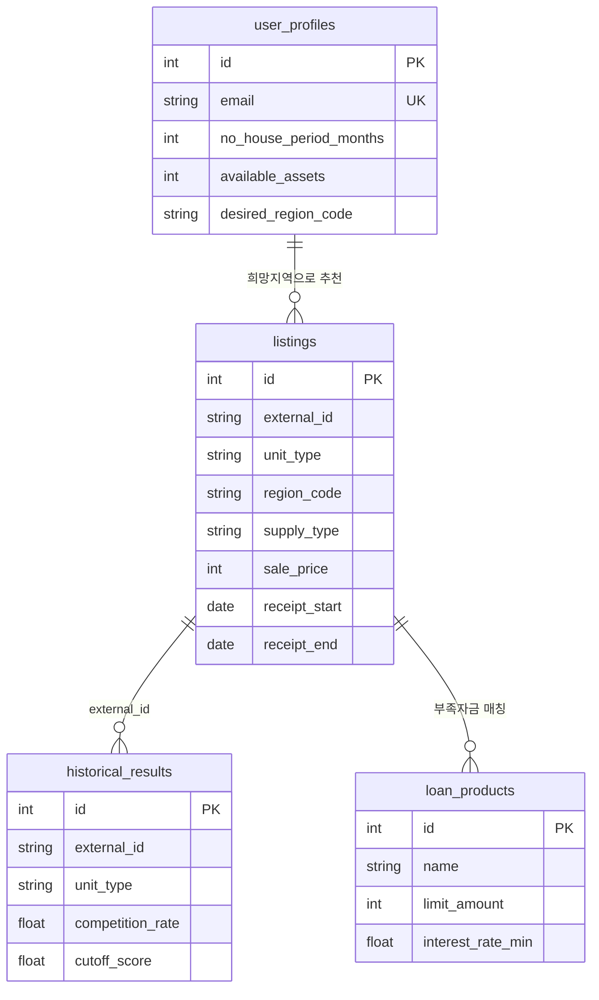

# ERD

정형 저장소는 PostgreSQL이다. 공고 질문 벡터는 1차에서 테이블에 넣지 않고, 조회 시 해당 공고 문장을 그 자리에서 검색한다. Vector DB는 RAG 평가 문서에서 역할을 나눌 때 추가한다.

관계 설명

- 사용자 1명 → 추천 목록 N건 (`desired_region_code` = `listings.region_code`)
- 공고 1건 → 과거 결과 N건 (`external_id`, 평형)
- 공고 1건 + 사용자 1명 → 대출 후보 N건 (한도 ≥ 부족 자금 또는 한도 없음)
