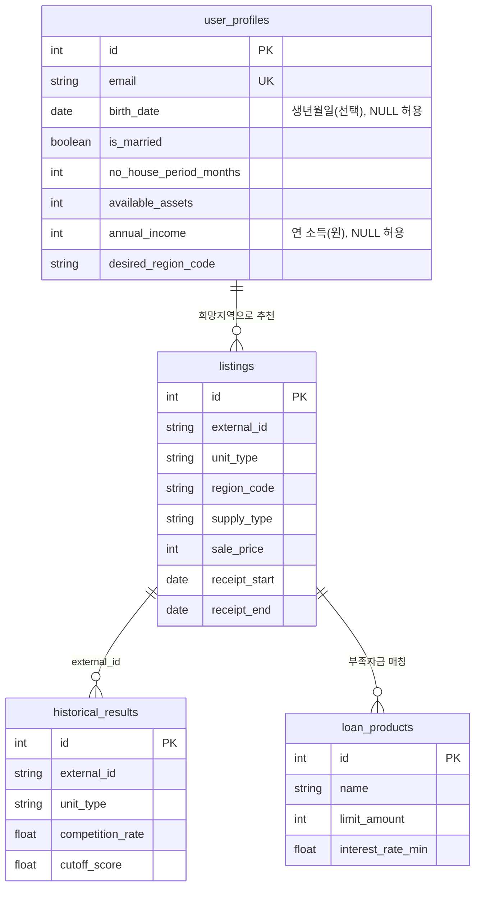

# ERD

정형 저장소는 PostgreSQL이다. 공고문 원문 조각과 임베딩 벡터는 별도의 벡터 DB(Chroma, `backend/data/vectordb/` 또는 `VECTOR_DB_PATH`)에 저장한다. 조각마다 (출처 `source`, 공고번호 `external_id`, 조각 순번, 원문 해시)를 붙여 두고, 질문할 때 열어 둔 공고의 조각만 조회한다. 구조와 평가는 RAG 결과보고서를 본다.

관계 설명

- 사용자 1명 → 추천 목록 N건 (`desired_region_code` = `listings.region_code`)
- 공고 1건 → 과거 결과 N건 (`external_id`, 평형)
- 공고 1건 + 사용자 1명 → 대출 후보 N건 (한도 ≥ 부족 자금 또는 한도 없음)
