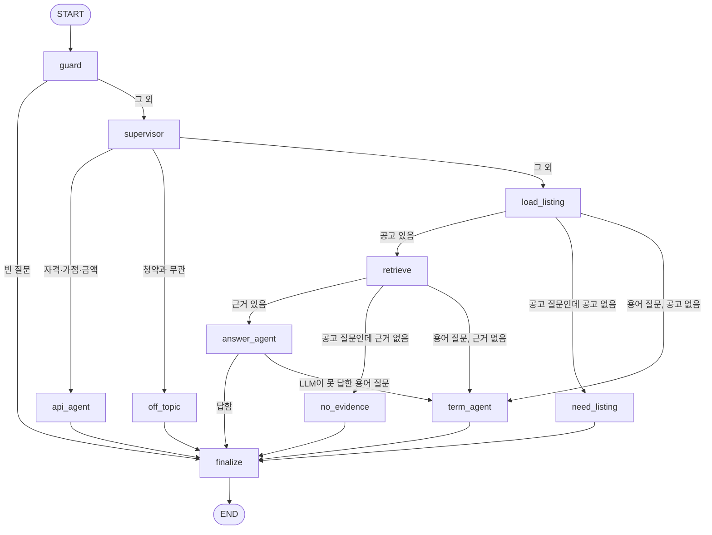

# 챗 그래프 구조 (LangGraph)

공고 질문 챗(`POST /chat/`)은 `backend/app/services/chat_graph.py`의 LangGraph 그래프가 처리한다.
예전에는 `chat()` 함수 하나에 if문이 중첩돼 있었다. 지금은 단계마다 노드로 나누고, 노드가 공유하는 상태와
다음에 갈 노드를 정하는 규칙(조건부 간선)을 따로 둔다. 질문별 응답 문구와 동작은 예전과 같다.

## 흐름

## 노드

| 노드 | 역할 | 하지 않는 것 |
|---|---|---|
| `guard` | 빈 질문을 걸러내고, 주민번호·전화번호·이메일·카드번호를 `[전화번호]`처럼 가린다 | 이름·주소·계좌번호는 가리지 못한다 (오탐이 많다) |
| `supervisor` | 질문 종류를 분류해 전문 노드로 보낸다 (`listing` / `term` / `api` / `other`) | |
| `api_agent` | 자격·가점·금액 질문에 계산 없이 추천·대출 API를 안내한다 (REQ-08) | 숫자를 계산하거나 LLM에 묻지 않는다 |
| `off_topic` | 청약과 무관한 질문을 정중히 거절하고 도울 수 있는 질문 예를 알려 준다 | 검색도 LLM도 부르지 않는다 |
| `load_listing` | 열어 둔 공고를 DB에서 불러온다 | |
| `retrieve` | 그 공고의 공고문 조각에서 근거를 찾는다 (RAG, REQ-07) | 다른 공고의 글은 읽지 않는다 |
| `answer_agent` | 근거가 있으면 LLM이 근거만 보고 풀어 쓴다. LLM을 못 쓰면 근거를 그대로 보여 준다 | 근거 밖의 내용을 지어내지 않는다 |
| `term_agent` | 공고 없이 하는 용어 질문. LLM이 용어만 설명하고, 못 쓰면 기본 안내문 | 자격·금액은 설명하지 않는다 |
| `need_listing` / `no_evidence` | 공고가 필요한데 없을 때, 공고문에 근거가 없을 때 "모른다"고 안내 | 이때는 LLM을 부르지 않는다 |
| `finalize` | 개인정보를 가렸다면 그 사실을 답변에 덧붙인다 | |

## 상태 (ChatState)

노드는 아래 상태를 읽고 바뀐 부분만 돌려준다. `trace`만 노드가 돌려주는 목록이 이어 붙는다.

| 필드 | 뜻 |
|---|---|
| `question`, `listing_id` | 입력 |
| `safe_question`, `pii_found` | 개인정보를 가린 질문과 발견한 종류. 분류·검색·LLM에는 `safe_question`만 쓴다 |
| `intent`, `listing`, `evidence`, `retriever` | 진행 중에 채워지는 값 |
| `answer`, `source` | 결과 (`source`: llm / local / api) |
| `trace` | 거친 노드 이름. 응답에 `trace`로 돌려줘서 한 질문이 어떤 단계를 거쳤는지 확인할 수 있다 |

## 설계 메모

- **LLM은 마지막에만, 근거와 함께만 쓴다.** 자격·금액 경로(`api_agent`)와 근거 없음 경로(`no_evidence`)에서는 LLM을 부르지 않는다. 시험으로 고정했다.
- **LLM이 실패해도 답은 나온다.** 키가 없거나 호출이 실패하면 근거 문장을 그대로 보여 주거나 기본 안내문으로 대체한다.
- **의존하는 것(db)은 실행할 때 넘긴다.** 그래프는 한 번만 컴파일하고, 요청마다 달라지는 DB 세션은 `config`로 넘긴다.
- **`recursion_limit`을 15로 둔다.** 지금 그래프는 되돌아가는 간선이 없지만, 나중에 생겨도 무한히 돌지 않게 하는 안전장치다.
- **알려진 약점:** 입구의 질문 분류 정확도는 시험지 기준 85.0%다. 특히 청약과 무관한 질문(65%)을 공고 질문으로 보내는 경우가 있다 (질문 분류 학습 결과서 참고).
